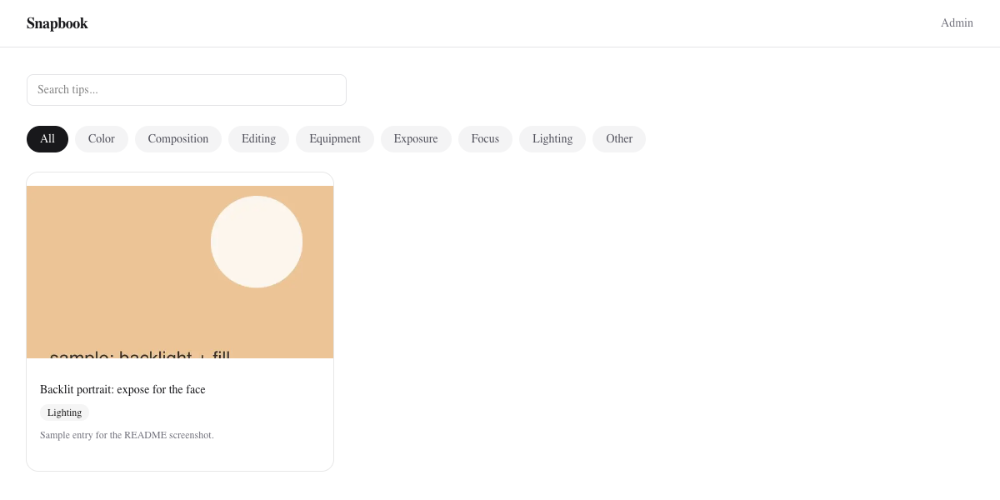

# Snapbook

Self-hosted gallery for photography tips. Save a tip as a screenshot upload, or pull frames out of a video URL (Instagram Reels and similar, via `yt-dlp`), then browse and search it by category.



## What it does

- Public gallery with text search and category filter; each tip has a detail page with Open Graph tags.
- Admin area (password login, JWT cookie) to add tips, delete tips, and review ingested videos.
- Upload: JPEG, PNG, WebP, MP4 or MOV, up to 100 MB. Images get a 640x480 thumbnail via `sharp`.
- Video ingest: `POST /api/ingest` with a URL downloads it with `yt-dlp` and extracts scene-change frames with `ffmpeg` in the background; the admin review page lets you save a frame as a tip.
- Storage is SQLite (`better-sqlite3`, Drizzle) plus files on disk. Eight preset categories are seeded on first start.

Stack: Next.js 16 (App Router), React 19, Tailwind 4, Vitest. Design notes are in `docs/superpowers/specs/`.

## Run locally

Requires Node 20+. `ffmpeg` and `yt-dlp` on `PATH` are needed only for video ingest.

```bash
npm ci
mkdir -p data
export DATA_DIR="$PWD/data" DATABASE_URL="$PWD/data/db.sqlite" \
       MEDIA_DIR="$PWD/data/media" THUMBS_DIR="$PWD/data/thumbs" \
       ADMIN_PASSWORD=change-me JWT_SECRET="$(openssl rand -hex 24)"
npm run dev        # http://localhost:3000
```

Use port 3000: the gallery and detail pages fetch their own API at `NEXT_PUBLIC_URL` (default `http://localhost:3000`), and Next.js inlines that value at build time.

Log in at `/admin/login`, upload an image from the admin page, and it appears in the gallery.

## Docker

```bash
cp .env.example .env     # set ADMIN_PASSWORD and JWT_SECRET
docker compose up -d --build
```

Data lives in the `snapbook_data` volume mounted at `/data`. `docker-compose.yml` falls back to `ADMIN_PASSWORD=changeme` and a fixed `JWT_SECRET` when they are unset, so set both. The login cookie is `Secure` when `NODE_ENV=production`; browsers only accept it over HTTPS (or on `localhost`), so put it behind a TLS proxy.

## Environment

| Variable | Default | Purpose |
| --- | --- | --- |
| `ADMIN_PASSWORD` | none (required) | Admin login |
| `JWT_SECRET` | built-in dev value | Signs the auth cookie; set your own |
| `DATABASE_URL` | `./data/db.sqlite` | SQLite file path |
| `MEDIA_DIR` | `/data/media` | Uploads and downloaded videos |
| `THUMBS_DIR` | `/data/thumbs` | Thumbnails |
| `DATA_DIR` | `/data` | Root served by `/api/media/*`; must contain `media/` and `thumbs/` |
| `MAX_VIDEO_SIZE_MB` | `500` | `yt-dlp --max-filesize` |

## Checks

```bash
npm test         # Vitest
npm run lint     # existing violations are warnings, see eslint.config.mjs
npx tsc --noEmit
npm run build
```

## Known gaps

- Video ingest and frame extraction write to hard-coded `/data/thumbs` and `/data/frames`, so they only work as-is in the Docker layout.
- Auth has no rate limiting.
- The tip table stores absolute file paths.
- Reading tips only works through the app's own HTTP API, so `NEXT_PUBLIC_URL` must match where it is served.

## License

MIT, see [LICENSE](LICENSE).
